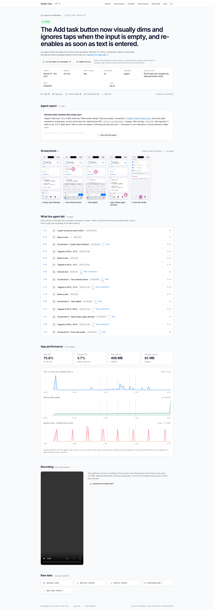

<h1 align="center">eas-simulator-evidence</h1>

<p align="center">
  Proof of what happened on an <a href="https://docs.expo.dev/preview/eas-simulator/introduction/">Expo Simulators</a> run, as one page anyone can open.<br>
  The verdict, the screenshots, every tap, the performance charts, and the recording. Static, shareable, no login.
</p>

<p align="center">
  <a href="https://www.npmjs.com/package/eas-simulator-evidence"></a>
  <a href="LICENSE"></a>
  
</p>

<p align="center">
  <a href="https://simple-todo--evidence-demo.expo.app"></a>
</p>

<p align="center">
  <a href="https://simple-todo--evidence-demo.expo.app"><strong>Open the live page</strong></a> · the verification run from <a href="https://github.com/jacobhammerle/todo-app/pull/7">a real pull request</a>
</p>

<br>

An agent or a script drives your app on Expo Simulators. When the session ends, this tool turns it into one static page and the link goes on the pull request. Reviewers open it in any browser, on any OS, with no Expo account.

## Why add it

- **Proof instead of claims.** The page shows the screens, the taps, and the recording behind an agent's "it works".
- **Any app, any driver.** Expo, React Native, Swift, or Kotlin. agent-device, argent, Appium, Maestro, or a shell script. The tool reads the session, not the code.
- **Built for CI.** The exit code follows the verdict. There is a JUnit file, a ready PR comment, and a GitHub Action.
- **Nothing to install, nothing to host.** Zero dependencies, and the output is a folder of static files.

## Give it a try

No simulator and no Expo account needed. A real run is checked into the repo.

```sh
git clone https://github.com/jacobhammerle/eas-simulator-evidence
cd eas-simulator-evidence
npm run demo
```

## What is on the page

- **The verdict**: `PASS`, `FAIL`, `REPLICATED`, `CONFIRMED`, `NOT-REPLICATED`, or `INCONCLUSIVE`, as a pill and a headline.
- **Screenshots** in capture order, each with a ring where the tap landed.
- **The timeline**: every tap, swipe, and screen read, with timing. A tap links to its screenshot. A time plays the recording from that moment.
- **Performance**: CPU, memory, and network for the whole run.
- **The agent's report**, the recording, a "Try this build" button, and the raw data.

One `index.html` plus assets. It opens from `file://`, works on a phone, and follows light or dark mode.

## How it works

You provide three things: a folder of screenshots, a subject, and a verdict line. Everything else comes from the session.

```sh
# 1. Start a cloud simulator with your build installed, then drive it your way
npx eas-cli@latest simulator:start --platform ios --type agent-device \
  --build-id "$BUILD_ID" --non-interactive --name "PR #12 evidence"
npx eas-cli@latest simulator:exec npx agent-device@latest screenshot evidence/1-home.png --platform ios

# 2. Write the verdict. Lines after the first become the report.
echo "PASS: the home screen rendered" > verdict.txt

# 3. Stop the session, collect its data, build the page, deploy it. The URL is the last line.
URL=$(npx eas-simulator-evidence@latest run evidence --stop --subject "PR #12" \
  --verdict-file verdict.txt --build-id "$BUILD_ID" --deploy-alias pr-12-evidence | tail -n 1)

# 4. Post it on the pull request
npx eas-simulator-evidence@latest comment evidence "$URL" --verdict-file verdict.txt | gh pr comment 12 --body-file -
```

Name screenshots `1-home.png`, `2-settings.png`, and so on. Add `--fail-on fail` to exit 3 on a FAIL once the site is up, so CI goes red. A project without an `app.json`, such as a native app, passes `--name`, `--owner`, and `--slug`.

## In CI

The runner never needs macOS. The simulator runs on EAS, and the job only sends commands. It needs `EXPO_TOKEN` as a secret and the id of an EAS build to install.

Copy a complete workflow into your project, then edit its "drive the app" step:

```sh
npx eas-simulator-evidence@latest init github-actions   # or: eas-workflows, gitlab-ci, local
```

Already have a workflow? Add the Action after the step that saves the screenshots. It stops the session, builds and deploys the page, and fails the job on a FAIL verdict:

```yaml
- uses: jacobhammerle/eas-simulator-evidence@v0
  with:
    subject: PR #${{ github.event.pull_request.number }}
    verdict-file: verdict.txt
    stop: true
    deploy-alias: pr-${{ github.event.pull_request.number }}-evidence
    fail-on: fail
  env:
    EXPO_TOKEN: ${{ secrets.EXPO_TOKEN }}
```

It outputs `url`, `kind`, `verdict`, and `site-dir`. Skip `deploy-alias` and upload `site-dir` to GitHub Pages, S3, Netlify, or anywhere else that serves static files.

## See it in a real project

[todo-app](https://github.com/jacobhammerle/todo-app) is a public Expo app built around agentic workflows on Expo Simulators, and it uses this package for every verdict. TestFlight feedback becomes a GitHub issue, an agent reproduces it on a simulator, another agent fixes it, two more review and verify the pull request, and a QA swarm runs lanes on iOS and Android. Each step leaves an evidence page on GitHub. Its [`.eas/workflows/`](https://github.com/jacobhammerle/todo-app/tree/main/.eas/workflows) folder is the place to start.

## Commands

```
eas-simulator-evidence run     <dir> --subject "<label>" --verdict "<line>"   collect, then build
eas-simulator-evidence build   <dir> --subject "<label>" --verdict "<line>"   build the site only
eas-simulator-evidence collect <dir> [--session <id>]                          pull the session data only
eas-simulator-evidence open    <dir>                                           serve the site on localhost
eas-simulator-evidence deploy  <dir> [--alias <name>]                          deploy to EAS Hosting
eas-simulator-evidence comment <dir> <siteUrl> --verdict "<line>"              a pull-request comment
eas-simulator-evidence thumbs  <dir> <siteUrl>                                 thumbnails for a comment
eas-simulator-evidence verdict "<line>" [--badge]                              normalize a verdict line
eas-simulator-evidence index   <dir-of-sites>                                  one page over many runs
eas-simulator-evidence sweep   [--older-than 30]                               stop stale preview sessions
eas-simulator-evidence init    <target>                                        copy a CI recipe into the project
```

Every command has `--help`. The full reference, the verdict grammar, the session data schema, and the programmatic API are in [docs/reference.md](docs/reference.md).

## Requirements

- Node 20 or newer. Expo SDK 58 tooling and eas-cli want 22 or newer, so use that in CI.
- An Expo account with Expo Simulators access, for `collect`, `deploy`, and `sweep`. In CI, set `EXPO_TOKEN`. Nothing else touches the network.

## For agents

Claude Code, Cursor, and other tools that read skills can use [skills/eas-simulator-evidence/SKILL.md](skills/eas-simulator-evidence/SKILL.md). It covers screenshot naming, the verdict line, and the command order.

## Contributing

Issues and PRs are welcome. See [CONTRIBUTING.md](CONTRIBUTING.md) and the [changelog](CHANGELOG.md).

## License

MIT
